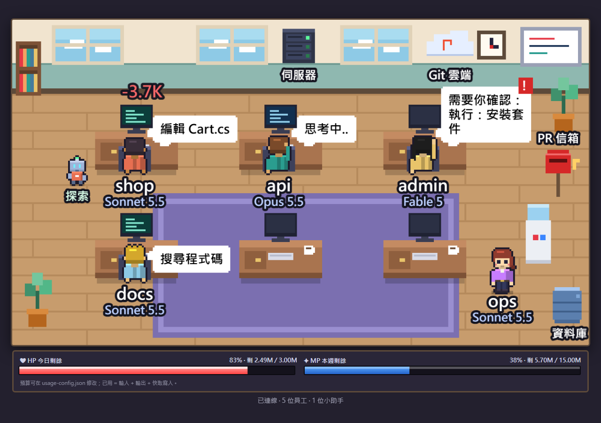
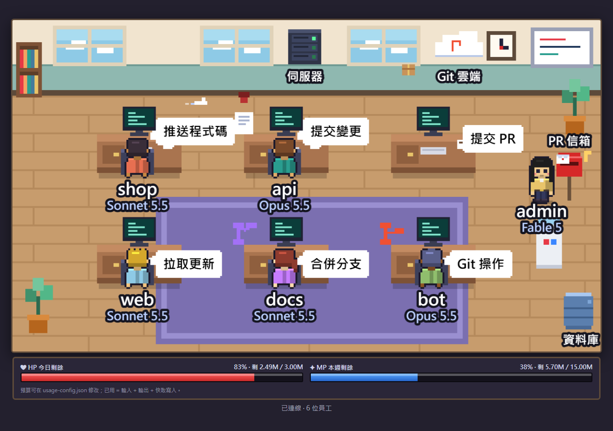
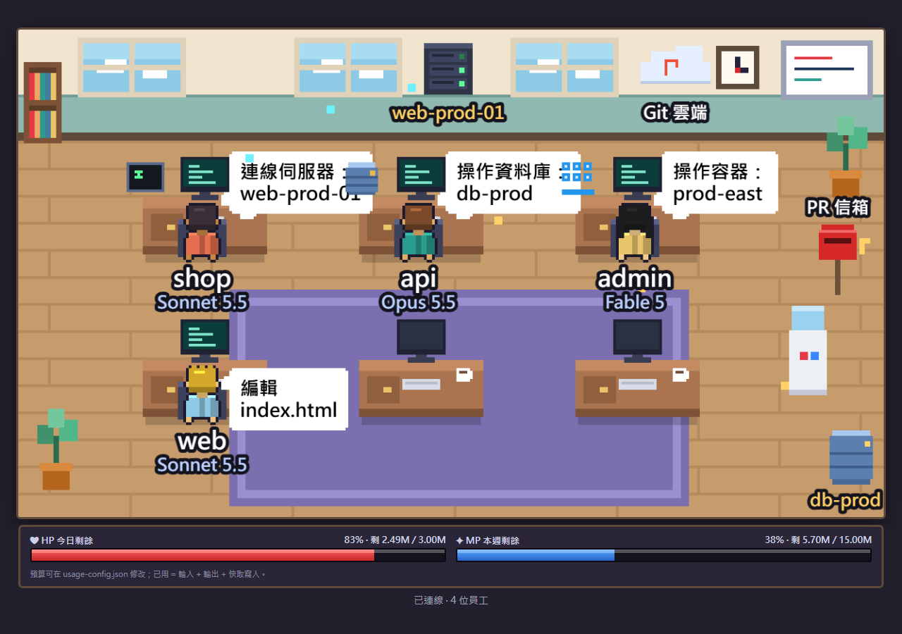
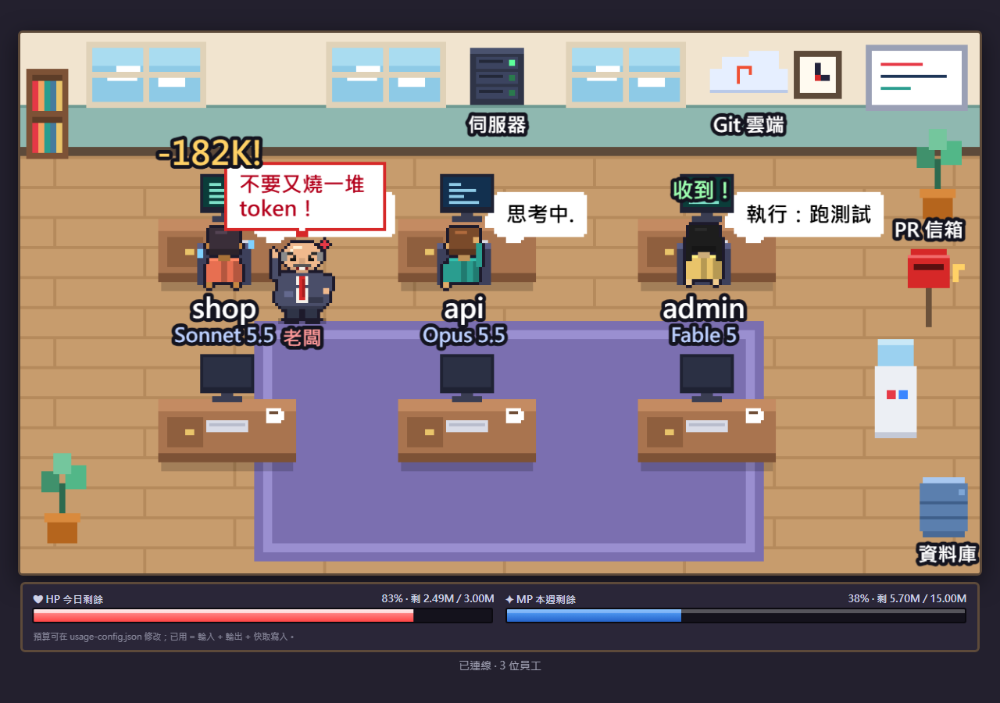
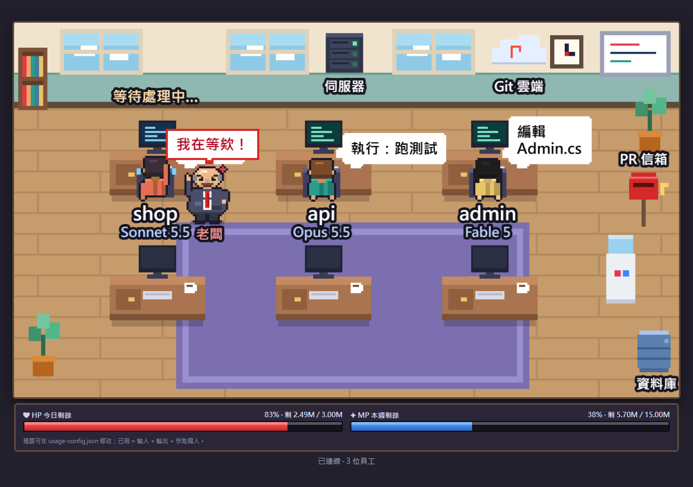
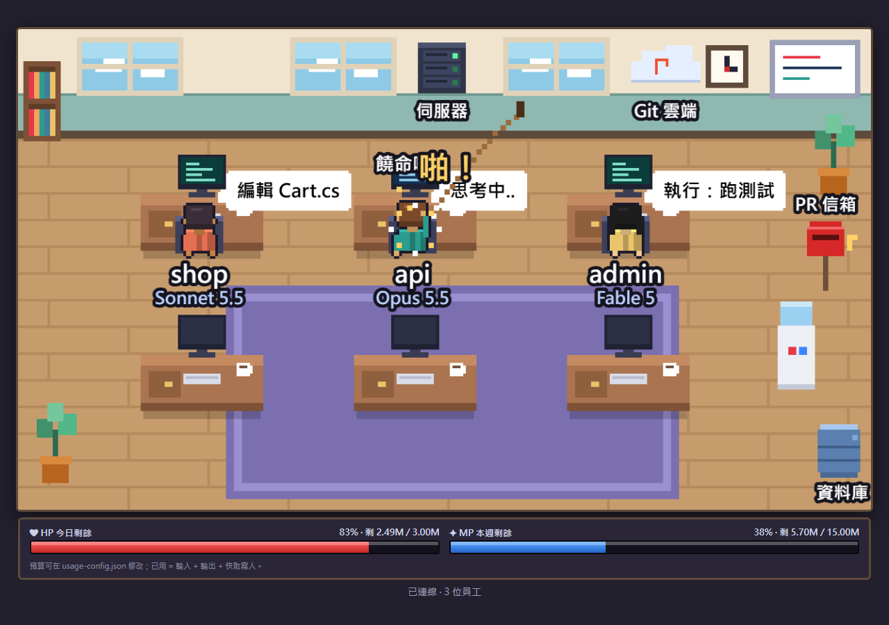

# 像素辦公室 · Pixel Office

> 把 **Claude Code** 的工作狀態，畫成一間會動的像素辦公室。
> *A zero-dependency, local-only pixel-art office that shows what your Claude Code sessions are doing — status, git / server / database actions, and token spend.*



每個 Claude Code 工作階段是辦公室裡的一位員工：打字、思考、等你確認、休息，全部看得到。還有幾個純娛樂的彩蛋：花太多 token 老闆會跑出來碎念，點小人還能鞭打（沒有任何意義）。

> ⚠️ 這是個人專案，**不是 Anthropic 官方產品**。Claude 是 Anthropic 的商標。

## 特色

- **零依賴**：只用 Node.js 內建模組，不用 `npm install`。
- **只限本機**：伺服器只監聽 `127.0.0.1`，沒有任何遠端／網路功能。
- **看得到在做什麼**：狀態動畫、白話對話框、使用的模型、助手（subagent）機器人。
- **看得到花多少**：HP／MP 用量條、頭上跳出的扣血數字。
- **一鍵安裝／移除**：先用白話說明會改什麼，你同意才動手，隨時可還原。

## 效果

### 一位員工 = 一個工作階段

| Claude 在做什麼 | 小人的樣子 |
|---|---|
| 編輯檔案、跑指令 | 坐在桌前打字，螢幕亮起，對話框顯示「編輯 Cart.cs」、「執行：跑測試」 |
| 思考 | 托著頭，對話框「思考中…」 |
| 需要你確認 | 舉手揮動，閃爍的紅色驚嘆號 |
| 休息 | 走到飲水機旁閒晃 |
| 派出助手（subagent） | 旁邊多出一個小機器人，結束就消失 |

名字取自**專案資料夾名稱**，名字下面顯示該工作階段用的模型（不同視窗可以用不同模型）。

### Git 與 Pull Request



| 操作 | 動畫 |
|---|---|
| `git commit` | 文件蓋章、出現綠色勾勾 |
| `git push` | 紙飛機飛向牆上的「Git 雲端」 |
| `git pull` / `fetch` / `clone` | 包裹從雲端飛下來 |
| `gh pr create`（提交 PR） | **小人離開座位，走到右邊的紅色信箱投信** |
| `merge` / `rebase` | 紫色的分支合併圖示 |
| 其他 `git` / `gh` | 分支圖示 |

### 伺服器、資料庫、容器



| 操作 | 動畫 |
|---|---|
| `ssh` / `scp` / `rsync` | 牆上機櫃燈號閃爍、封包飛過去，**顯示連到哪一台主機** |
| `mysql` / `psql` / `sqlcmd` / `mongosh` / `redis-cli` / `sqlite3`… | 資料庫圓柱亮起，**顯示哪一台資料庫** |
| `docker` / `kubectl` | 一疊貨櫃跳動（kubectl 顯示 context 名稱） |

只會顯示**主機名稱**，帳號、密碼、連線字串、SQL 都不會被讀取或顯示。

### 用量：HP／MP 條與扣血數字

畫面下方的紅色 **HP** 是今日剩餘、藍色 **MP** 是近 7 天剩餘。每次 Claude 回應完成，花掉的 token 會從那個小人頭上跳出來，單次超過 5 萬會變成黃色的「暴擊」。

> 「剩餘」是用你在 `usage-config.json` 設定的預算算的，**不是官方額度**。已用 = 輸入 + 輸出 + 快取寫入（不含快取讀取）。數字取自 Claude 在本機寫的對話紀錄，會比實際動作晚幾秒。

### 老闆來了，還有「收到！」



- 你送出訊息的瞬間，小人會跳一下並冒出 **「收到！」**。
- **老闆**（禿頭、大肚子、紅領帶）有時會走過來碎念；**單次花超過 5 萬 token 一定會來**。
- 台詞是預先寫好的罐頭台詞，**不是根據你輸入的內容**；你的提問文字不會被讀取或送出。
- 出現機率、間隔、台詞可以在 `web/main.js` 開頭調整。

### 訊息在排隊？老闆會一直催，直到它開始處理



在 Claude 還在忙的時候又送出一則訊息，那則訊息會先排隊。這時老闆會**跑**過來（比平常快），站在那個小人旁邊**一直碎念**（台詞每幾秒換一句：「快一點啦！」「怎麼這麼慢？！」「我在等欸！」…），小人頭上顯示 **「等待處理中…」**。等 Claude 真正開始處理那則訊息，小人說「收到！」，老闆才走。多個視窗同時在等，老闆會一個一個處理。

這純粹是畫面效果，**不會影響 Claude**，只是讓你一眼看出「我的訊息還在排隊」。

### 鞭打（純屬搞笑，沒有任何意義）



用滑鼠點任何一個小人（或助手機器人）：鞭子甩下「啪！」，小人抖一下、冒星星、喊「哎呀！」。**不會送出任何東西，也不會改變任何狀態。** 點老闆本人他會罵你。

## 安裝

**需求**：Windows、[Node.js](https://nodejs.org)（LTS）、Edge 或 Chrome、較新版的 Claude Code（助手機器人需要它支援 `SubagentStart` hook）。

### 方法 A：一鍵安裝（建議）

1. 下載本專案（網頁右上角 **Code → Download ZIP**，或 `git clone`），解壓縮到任何位置。
2. 雙擊 **`install.bat`**。它會先列出：
   - 要做的 4 件事（檢查 Node.js、**備份**你的 Claude 設定檔、加入 9 個 hooks、建立桌面捷徑）
   - 它**不會**做的事（不連網、不裝其他軟體、不改系統設定）
   - 會用到哪些資料（全部只在你的電腦內傳遞）

   然後等你輸入 `Y` 才會動手。
3. 完成後**關掉所有已開著的 Claude Code 視窗再重新開啟**（舊視窗不會載入新設定）。
4. 雙擊桌面的 **「像素辦公室」**，會開出一個獨立視窗（沒有網址列和分頁）。關掉視窗時伺服器會一起關掉。

> 從網路下載的 `.bat` 檔，Windows 可能會跳出 SmartScreen 警告，這是正常的；也可以先用文字編輯器看過 `install.bat` 和 `install.ps1` 再執行。

**移除**：雙擊 `uninstall.bat`（同樣先說明、再詢問）。它只移除指向這個資料夾的 hooks，你自己的其他設定與 hooks 不會被動到，並且會再備份一次。

### 方法 B：手動安裝

1. 啟動伺服器：`node server/server.js`，用瀏覽器開 <http://127.0.0.1:8787>。
2. 把下面這段 hooks 合併進 `~/.claude/settings.json`（路徑改成你放這個專案的位置）：

```json
{
  "hooks": {
    "SessionStart":     [{ "hooks": [{ "type": "command", "command": "node \"/path/to/claude-pixel-office/hook/send.js\"" }] }],
    "UserPromptSubmit": [{ "hooks": [{ "type": "command", "command": "node \"/path/to/claude-pixel-office/hook/send.js\"" }] }],
    "PreToolUse":       [{ "hooks": [{ "type": "command", "command": "node \"/path/to/claude-pixel-office/hook/send.js\"" }] }],
    "PostToolUse":      [{ "hooks": [{ "type": "command", "command": "node \"/path/to/claude-pixel-office/hook/send.js\"" }] }],
    "Notification":     [{ "hooks": [{ "type": "command", "command": "node \"/path/to/claude-pixel-office/hook/send.js\"" }] }],
    "Stop":             [{ "hooks": [{ "type": "command", "command": "node \"/path/to/claude-pixel-office/hook/send.js\"" }] }],
    "SessionEnd":       [{ "hooks": [{ "type": "command", "command": "node \"/path/to/claude-pixel-office/hook/send.js\"" }] }],
    "SubagentStart":    [{ "hooks": [{ "type": "command", "command": "node \"/path/to/claude-pixel-office/hook/send.js\"" }] }],
    "SubagentStop":     [{ "hooks": [{ "type": "command", "command": "node \"/path/to/claude-pixel-office/hook/send.js\"" }] }]
  }
}
```

> 只在 **Windows** 測試過。macOS／Linux 理論上伺服器和網頁可以跑（方法 B），但一鍵安裝、桌面視窗和捷徑都是 Windows 專用，且未經測試。

## 隱私與安全

這個工具會讀你的 Claude Code 活動，所以把話說清楚：

- **只在本機**：伺服器只綁 `127.0.0.1`，並檢查 `Host` 標頭防 DNS rebinding；拒絕帶 `Origin` 的請求。**刻意沒有任何遠端模式。**
- **hook 只會送出**：工作階段 ID、專案資料夾名稱、狀態、一段短描述（檔案名稱，或 Claude 自己寫的指令說明）、動作類別（例如「推送」、「資料庫」）、**僅限 ssh／資料庫／kubectl 的主機名稱**、模型名稱，以及「有人送出訊息」的一個布林旗標。
- **絕不送出**：你的提問文字、指令本身與參數、帳號、密碼、連線字串、SQL、連接埠、路徑、檔案內容、工具輸出。
- **用量**：讀 `~/.claude/projects` 裡 Claude 寫的對話紀錄，只取 token 數量、模型名稱、工作階段 ID；不保存對話內容。
- **「訊息在排隊」偵測**：同一份對話紀錄裡有 `queue-operation`（排隊／取出）記錄。程式只用文字比對取出「動作」那個字（enqueue／remove／dequeue）和工作階段 ID，**不解析、不保存、不轉送你的訊息內容**。
- **安裝器**：修改你的設定檔前先備份成 `settings.json.pixel-office-backup-日期時間`；寫完會驗證，失敗自動還原；設定檔格式不標準時會拒絕並完全不動它。
- 這些規則都有自動測試（見下方「開發」），例如用假密碼確認它不會出現在任何送出的資料裡。

## 設定

- **用量預算**：編輯 `usage-config.json` 的 `dailyBudget`、`weeklyBudget`（token 數）。
- **老闆與特效**：`web/main.js` 開頭的 `BOSS_CHANCE`、`BOSS_COOLDOWN_MS`、`BOSS_SPEND_MIN`、`BOSS_LINES`。
- **連接埠**：預設 8787，可用環境變數 `PORT`（伺服器）與 `PIXEL_OFFICE_PORT`（hook）修改。

## 已知限制

- 只在 Windows 測試。
- 針對 **Claude Code**。Claude 桌面版的 **Cowork** 模式沒有驗證過，官方文件也沒有說明是否支援 Claude Code 的 hooks，**很可能不能直接用**。
- 「剩餘用量」不是官方數字（見上）。
- 扣血數字、「等待處理中」都會比實際動作晚約 1–3 秒（輪詢本機對話紀錄）。
- 「訊息在排隊」依賴 Claude Code 對話紀錄裡的 `queue-operation` 格式。這是 Claude Code 的內部格式，未來版本可能改變，到時這個功能會失效（其他功能不受影響）。
- 已經開著的 Claude Code 視窗不會載入新安裝的 hooks，要重新開啟。

## 開發

```
hook/send.js              Claude Code hook：分類 → POST 到本機（只送上面列的欄位）
server/server.js          本機伺服器：POST /event、GET /events (SSE)、GET /usage、靜態檔
server/usage.js           增量讀取本機對話紀錄，統計 token
web/                      Canvas 前端：房間、人物（程式生成像素圖）、老闆、特效、HUD
install.bat / uninstall.bat / pack.bat   安裝、移除、打包給別人用的 zip
tools/settings-hooks.js   安全地修改 settings.json（嚴格 JSON、備份、驗證、可還原）
tests/                    測試與預覽工具
docs/                     README 用的截圖與產生它們的情境檔
.claude/skills/pixel-office/SKILL.md   給 Claude Code 讀的專案說明（架構、隱私規則、已知的坑）
```

```bash
node tests/hook_classify_test.js    # 指令分類 + 隱私（用假密碼驗證不外洩）
node tests/prompt_event_test.js     # 「送出訊息」信號；確認提問文字不外洩
node tests/spend_test.js            # 扣血數字（用假的家目錄，約 25 秒）
node tests/waiting_test.js          # 「訊息在排隊」偵測；確認排隊的訊息內容不外洩（假家目錄，約 20 秒）
node tests/boss_logic_test.js       # 老闆的決策邏輯（用無頭瀏覽器跑真正的頁面，需要 Edge 或 Chrome）
node tests/installer_test.js        # 安裝器（用拋棄式設定檔，不碰真正的 ~/.claude）

# 用假資料重新產生 README 的截圖（需要 Edge 或 Chrome）
node tests/preview.js docs/scenarios/boss.json docs/images/boss.png
```

## 授權

[MIT](LICENSE)
